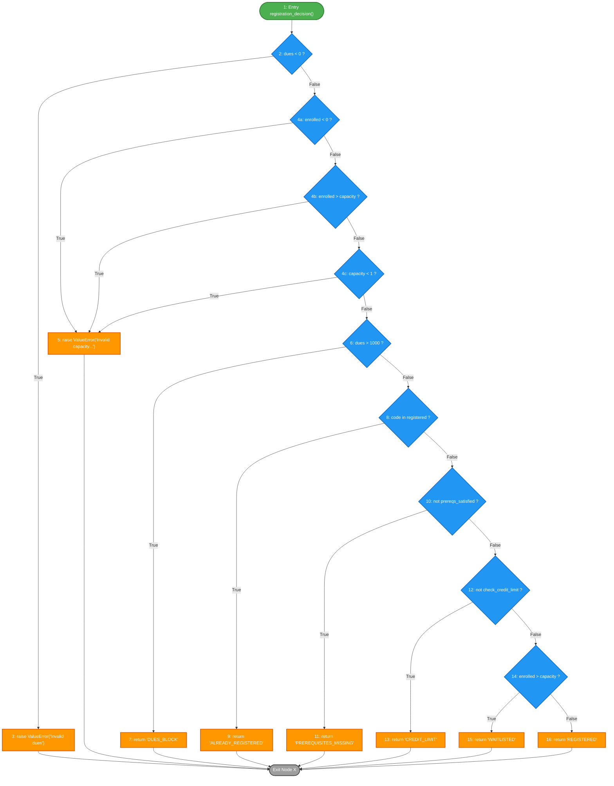

# B1. Control Flow Graph (CFG) and Cyclomatic Complexity Analysis

**Course:** SE3002 Software Quality Engineering  
**Artifact:** Assignment 2 — White-Box Testing & Structural Coverage  
**Target Function:** `registration_decision(student: Student, course: Course)` in `registration.py`

---

## 1. Source Code Under Analysis

```python
44: def registration_decision(student: Student, course: Course) -> str:
45:     """Evaluate registration without changing student or course state."""
46:     if student.outstanding_dues < 0:
47:         raise ValueError("Invalid dues")
48:     if not 0 <= course.enrolled <= course.capacity or course.capacity < 1:
49:         raise ValueError("Invalid capacity or enrollment")
50:     if student.outstanding_dues > 1000:
51:         return "DUES_BLOCK"
52:     if course.code in student.registered_courses:
53:         return "ALREADY_REGISTERED"
54:     if not prerequisites_satisfied(student.completed_courses, course.prerequisites):
55:         return "PREREQUISITES_MISSING"
56:     if not check_credit_limit(student.current_credits, course.credit_hours):
57:         return "CREDIT_LIMIT"
58:     if course.enrolled > course.capacity:
59:         return "WAITLISTED"
60:     return "REGISTERED"
```

---

## 2. CFG Conventions for Short-Circuit Compound Expressions

In Python, compound Boolean expressions with logical operators (`and`, `or`, and chained comparisons like `0 <= course.enrolled <= course.capacity`) undergo **short-circuit evaluation** from left to right. Specifically, line 48:
$$\text{not } (0 \le \text{enrolled} \le \text{capacity}) \text{ or } (\text{capacity} < 1)$$
decomposes at the Python AST and bytecode level into three distinct predicate evaluation steps:
1. **$C_{48a}$**: Check $0 \le \text{course.enrolled}$. If False ($\text{enrolled} < 0$), the chained comparison is False, so $\text{not False}$ is True, and the `or` short-circuits immediately to execute line 49 (`raise ValueError`).
2. **$C_{48b}$**: If $0 \le \text{course.enrolled}$ is True, check $\text{course.enrolled} \le \text{course.capacity}$. If False ($\text{enrolled} > \text{capacity}$), the chained comparison is False, $\text{not False}$ is True, and the `or` short-circuits immediately to execute line 49.
3. **$C_{48c}$**: If both chained checks pass, $0 \le \text{enrolled} \le \text{capacity}$ is True, so $\text{not True}$ is False. The left-hand side of `or` is False, so Python evaluates the right-hand operand: $\text{course.capacity} < 1$. If True, line 49 is executed; if False, execution falls through to line 50.

Because of this semantic reality, two conventions exist in Software Quality Engineering:

* **Convention A (Atomic / Short-Circuit Predicate Decomposed CFG — McCabe's Standard):** Each short-circuit atomic predicate is modeled as its own decision node. This reflects the true runtime branch points of the compiled bytecode.
* **Convention B (Statement-Level CFG):** Each `if` statement is treated as a single decision node regardless of compound Boolean complexity.

We document and calculate Cyclomatic Complexity for **both conventions**, proving their mathematical consistency.

---

## 3. Node Taxonomy Table

### 3.1 Convention A: Short-Circuit Decomposed Nodes

| Node ID | Line(s) | Node Type | Description / Condition |
|:---:|:---:|:---:|:---|
| **1** | 44–45 | Processing (Entry) | Function entry, parameter receipt (`student`, `course`) |
| **2** | 46 | Decision | `student.outstanding_dues < 0` |
| **3** | 47 | Return / Exit | `raise ValueError("Invalid dues")` |
| **4a** | 48 | Decision | `course.enrolled < 0` (negated first half of chained comparison) |
| **4b** | 48 | Decision | `course.enrolled > course.capacity` (negated second half of chained comparison) |
| **4c** | 48 | Decision | `course.capacity < 1` (second operand of `or`) |
| **5** | 49 | Return / Exit | `raise ValueError("Invalid capacity or enrollment")` |
| **6** | 50 | Decision | `student.outstanding_dues > 1000` |
| **7** | 51 | Return / Exit | `return "DUES_BLOCK"` |
| **8** | 52 | Decision | `course.code in student.registered_courses` |
| **9** | 53 | Return / Exit | `return "ALREADY_REGISTERED"` |
| **10** | 54 | Decision | `not prerequisites_satisfied(...)` |
| **11** | 55 | Return / Exit | `return "PREREQUISITES_MISSING"` |
| **12** | 56 | Decision | `not check_credit_limit(...)` |
| **13** | 57 | Return / Exit | `return "CREDIT_LIMIT"` |
| **14** | 58 | Decision | `course.enrolled > course.capacity` |
| **15** | 59 | Return / Exit | `return "WAITLISTED"` |
| **16** | 60 | Return / Exit | `return "REGISTERED"` |
| **X** | Exit | Virtual Exit Node | Common sink absorbing all returns/exceptions |

* **Total Nodes (excluding X):** $N = 18$ (1 Entry, 9 Decision nodes, 8 Terminal nodes)  
* **Total Nodes (including common Exit X):** $N' = 19$

---

## 4. Edge Listing and Flow Graph

### 4.1 Edge Table (Convention A)

| Edge # | Source Node | Target Node | Branch Condition | Description |
|:---:|:---:|:---:|:---:|:---|
| 1 | 1 | 2 | Sequential | Entry to first dues validation |
| 2 | 2 | 3 | True | `outstanding_dues < 0` -> raise ValueError |
| 3 | 2 | 4a | False | `outstanding_dues >= 0` -> evaluate enrollment >= 0 |
| 4 | 4a | 5 | True | `enrolled < 0` -> short-circuit raise ValueError |
| 5 | 4a | 4b | False | `enrolled >= 0` -> evaluate enrolled <= capacity |
| 6 | 4b | 5 | True | `enrolled > capacity` -> short-circuit raise ValueError |
| 7 | 4b | 4c | False | `enrolled <= capacity` -> evaluate capacity < 1 |
| 8 | 4c | 5 | True | `capacity < 1` -> raise ValueError |
| 9 | 4c | 6 | False | Capacity & enrollment valid -> evaluate dues > 1000 |
| 10 | 6 | 7 | True | `dues > 1000` -> return "DUES_BLOCK" |
| 11 | 6 | 8 | False | `dues <= 1000` -> evaluate already registered |
| 12 | 8 | 9 | True | `course in registered` -> return "ALREADY_REGISTERED" |
| 13 | 8 | 10 | False | `course not in registered` -> evaluate prerequisites |
| 14 | 10 | 11 | True | Prerequisites unsatisfied -> return "PREREQUISITES_MISSING" |
| 15 | 10 | 12 | False | Prerequisites satisfied -> evaluate credit limit |
| 16 | 12 | 13 | True | Credit limit violated -> return "CREDIT_LIMIT" |
| 17 | 12 | 14 | False | Credit limit acceptable -> evaluate waitlist condition |
| 18 | 14 | 15 | True | `enrolled > capacity` -> return "WAITLISTED" |
| 19 | 14 | 16 | False | `enrolled <= capacity` -> return "REGISTERED" |

* **Internal Edges:** $E = 19$
* **Edges to Virtual Sink X:** Connecting each of the 8 exit nodes (3, 5, 7, 9, 11, 13, 15, 16) to $X$ adds 8 edges $\implies E' = 19 + 8 = 27$.

---

### 4.2 Visual CFG Diagram (Mermaid)



---

## 5. Calculation of Cyclomatic Complexity $V(G)$

### 5.1 Calculation under Convention A (Short-Circuit Atomic Predicates)

1. **Formula 1: Graph Theory Definition $V(G) = E' - N' + 2P$ (Single Connected Component $P=1$)**
   When the control flow graph is completed with a common virtual exit node $X$:
   - Total Nodes: $N' = 19$
   - Total Edges: $E' = 27$
   $$V(G) = 27 - 19 + 2(1) = 10$$

2. **Formula 2: Predicate Node Rule $V(G) = D + 1$**
   Decision nodes in the graph:
   - Node 2 (`dues < 0`)
   - Node 4a (`enrolled < 0`)
   - Node 4b (`enrolled > capacity`)
   - Node 4c (`capacity < 1`)
   - Node 6 (`dues > 1000`)
   - Node 8 (`code in registered`)
   - Node 10 (`prereqs unsatisfied`)
   - Node 12 (`credit limit exceeded`)
   - Node 14 (`enrolled > capacity`)
   Total decision predicates: $D = 9$.
   $$V(G) = D + 1 = 9 + 1 = 10$$

3. **Formula 3: Region Count $V(G) = R$**
   In a planar representation of the flowgraph with common exit sink, there are 9 enclosed bounded regions plus 1 unbounded external region:
   $$V(G) = 9 + 1 = 10$$

---

### 5.2 Calculation under Convention B (Statement-Level Decision Nodes)

When the compound expression on line 48 is treated as a single composite decision block:
- **Nodes:** $N_{stmt} = 16$ (excluding X), $N_{stmt}' = 17$ (including X)
- **Edges:** $E_{stmt} = 15$ (internal), $E_{stmt}' = 15 + 8 = 23$ (with exits to X)
- **Decision Nodes:** $D_{stmt} = 7$ (Nodes 2, 4, 6, 8, 10, 12, 14)

1. **$V(G) = E_{stmt}' - N_{stmt}' + 2 = 23 - 17 + 2 = 8$**
2. **$V(G) = D_{stmt} + 1 = 7 + 1 = 8$**

### 5.3 Formal Comparison of Conventions

| Metric | Convention A (Short-Circuit AST) | Convention B (Statement-Level) | Difference Rationale |
|:---|:---:|:---:|:---|
| **Decision Nodes ($D$)** | 9 | 7 | Compound `or` and chained comparison add 2 internal decision points |
| **Total Nodes ($N'$)** | 19 | 17 | Nodes 4a, 4b, 4c vs single Node 4 |
| **Total Edges ($E'$)** | 27 | 23 | Short-circuit evaluation paths add 4 directed edges |
| **$V(G) = E - N + 2$** | **10** | **8** | Exact match with $D + 1$ in both models |

---

## 6. Independent Basis Path Set and Representative Tests

An independent basis path set consists of linearly independent execution paths such that every edge in the graph is traversed at least once, and each path introduces at least one edge not present in any previous path.

We present the full basis path set for $V(G) = 10$ (Convention A), which subsumes Convention B.

### 6.1 Basis Path Matrix

| Path ID | Node Sequence | New Edge(s) Introduced | Expected Outcome | Representative Test Case / Inputs |
|:---:|:---|:---:|:---|:---|
| **Path 1** | $1 \to 2 \to 3 \to X$ | $1 \to 2$, $2 \to 3$ | `ValueError("Invalid dues")` | `student(outstanding_dues=-1)`, `course()` |
| **Path 2** | $1 \to 2 \to 4a \to 5 \to X$ | $2 \to 4a$, $4a \to 5$ | `ValueError("Invalid capacity...")` | `student(outstanding_dues=0)`, `course(enrolled=-1, capacity=10)` |
| **Path 3** | $1 \to 2 \to 4a \to 4b \to 5 \to X$ | $4a \to 4b$, $4b \to 5$ | `ValueError("Invalid capacity...")` | `student(outstanding_dues=0)`, `course(enrolled=11, capacity=10)` |
| **Path 4** | $1 \to 2 \to 4a \to 4b \to 4c \to 5 \to X$ | $4b \to 4c$, $4c \to 5$ | `ValueError("Invalid capacity...")` | `student(outstanding_dues=0)`, `course(enrolled=0, capacity=0)` |
| **Path 5** | $1 \to 2 \to 4a \to 4b \to 4c \to 6 \to 7 \to X$ | $4c \to 6$, $6 \to 7$ | `"DUES_BLOCK"` | `student(outstanding_dues=1001)`, `course()` |
| **Path 6** | $1 \to 2 \to 4a \to 4b \to 4c \to 6 \to 8 \to 9 \to X$ | $6 \to 8$, $8 \to 9$ | `"ALREADY_REGISTERED"` | `student(registered_courses={"C1"})`, `course(code="C1")` |
| **Path 7** | $1 \to 2 \to 4a \to 4b \to 4c \to 6 \to 8 \to 10 \to 11 \to X$ | $8 \to 10$, $10 \to 11$ | `"PREREQUISITES_MISSING"` | `student(completed_courses=set())`, `course(prerequisites={"P1"})` |
| **Path 8** | $1 \to 2 \to 4a \to 4b \to 4c \to 6 \to 8 \to 10 \to 12 \to 13 \to X$ | $10 \to 12$, $12 \to 13$ | `"CREDIT_LIMIT"` | `student(current_credits=16)`, `course(credit_hours=3)` |
| **Path 9** | $1 \to 2 \to 4a \to 4b \to 4c \to 6 \to 8 \to 10 \to 12 \to 14 \to 15 \to X$ | $12 \to 14$, $14 \to 15$ | `"WAITLISTED"` | `student()`, `DynamicCourse(capacity=10)` (enrolled 5 at 48, 15 at 58) |
| **Path 10** | $1 \to 2 \to 4a \to 4b \to 4c \to 6 \to 8 \to 10 \to 12 \to 14 \to 16 \to X$ | $14 \to 16$ | `"REGISTERED"` | `student(current_credits=10)`, `course(enrolled=5, capacity=10)` |

### 6.2 Structural Anomaly Note on Path 9
In the supplied implementation of `registration.py`:
- Line 48: `if not 0 <= course.enrolled <= course.capacity or course.capacity < 1: raise ValueError(...)`
- Line 58: `if course.enrolled > course.capacity: return "WAITLISTED"`

For standard immutable/static `Course` objects, any input where `enrolled > capacity` is trapped at Line 48 and raises `ValueError`. Consequently, Line 58's True branch ($14 \to 15$) is structurally unreachable with static objects. To exercise Path 9 in structural white-box testing, a dynamic course property is utilized to simulate state change between validation (line 48) and the waitlist evaluation (line 58). This demonstrates the power of white-box CFG analysis to discover unreachable dead-code defects.
